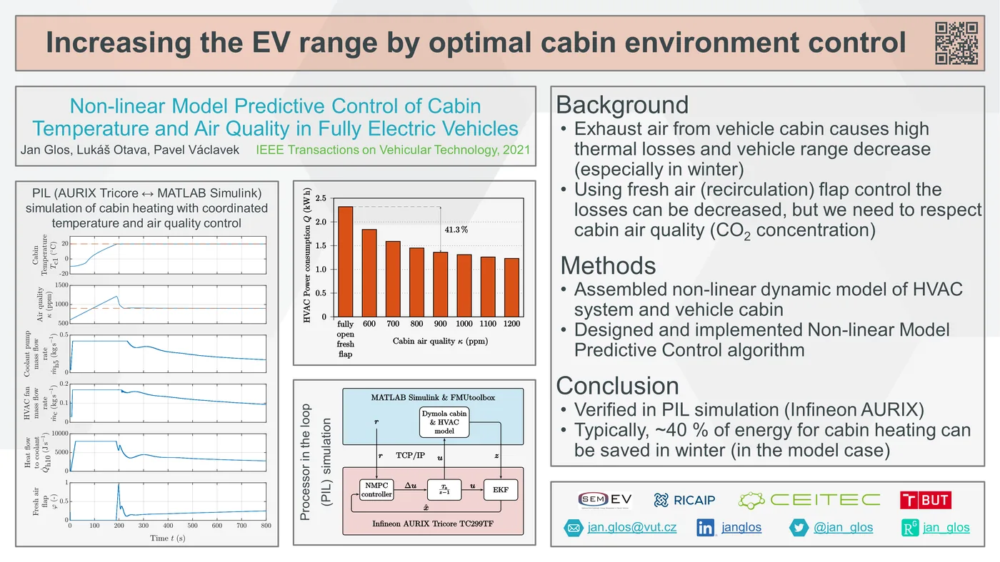
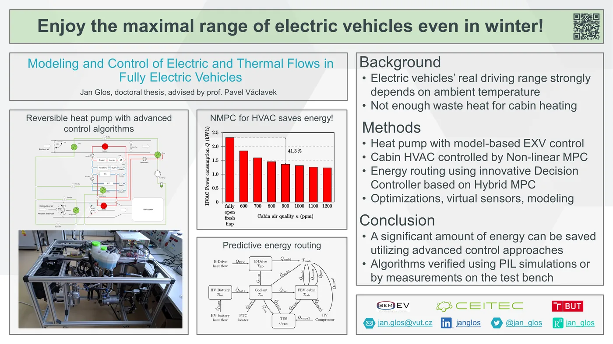
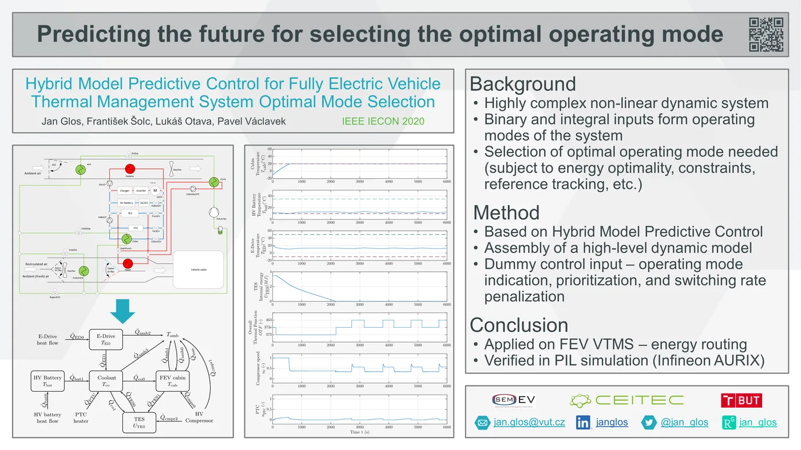
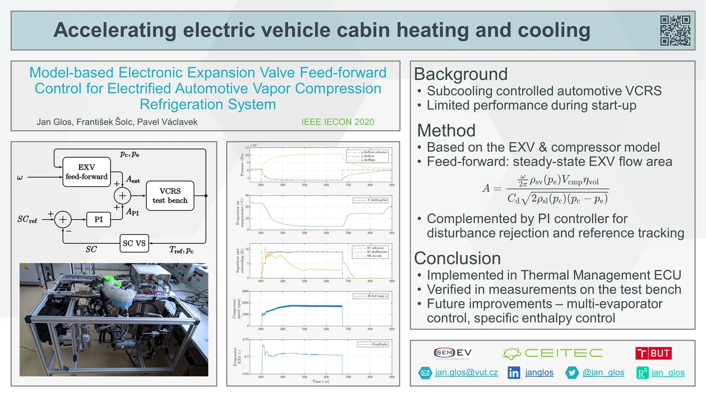
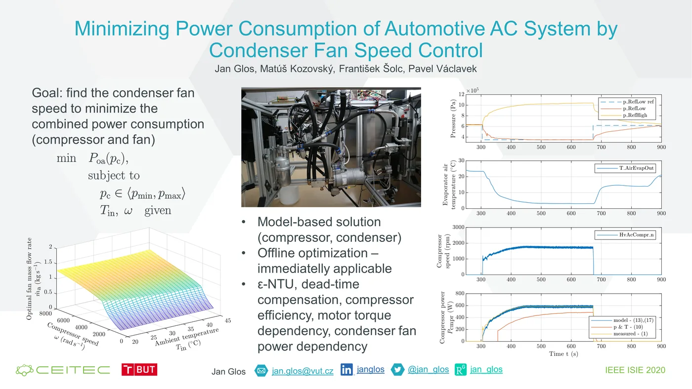

  <a class="btn btn--inverse btn--small" href="https://scholar.google.com/citations?user=eyOXkfYAAAAJ&hl=cs&oi=ao">Google Scholar</a>
  <a class="btn btn--inverse btn--small" href="https://orcid.org/0000-0001-9636-1529">ORCID</a>
  <a class="btn btn--inverse btn--small" href="https://www.researchgate.net/profile/Jan-Glos">ResearchGate</a>
  <a class="btn btn--inverse btn--small" href="https://ieeexplore.ieee.org/author/37086016018">IEEE Xplore</a>

#### Non-Linear Model Predictive Control of Cabin Temperature and Air Quality in Fully Electric Vehicles
J. Glos, L. Otava, and P. Václavek  
IEEE Transactions on Vehicular Technology, vol. 70, no. 2, pp. 1216-1229, Feb. 2021, doi: 10.1109/TVT.2021.3054170.

[{: width="60%" loading="lazy"}](/assets/pitch/IEEE_TVT_NMPC_T_AQ.png)

[Download paper (PDF, 4.5 MB)](/assets/pdf/2021_TVT_NMPC_T_AQ.pdf)

#### Modeling and Control of Electric and Thermal Flows in Fully Electric Vehicles
J. Glos, advised by prof. Ing. Pavel Václavek, Ph.D.  
Brno, 2020, 207 p., Doctoral thesis. Brno University of Technology, Faculty of Electrical Engineering and Communication, Department of Control and Instrumentation.

[{: width="60%" loading="lazy"}](/assets/pitch/phdThesisGlos_poster.png)

[Download thesis (PDF, 18.2 MB)](/assets/pdf/2020_phdThesisGlos.pdf) · [Download thesis summary (PDF, 4.8 MB)](/assets/pdf/2020_phdThesisGlosSummary.pdf)

#### Hybrid Model Predictive Control for Fully Electric Vehicle Thermal Management System Optimal Mode Selection
J. Glos, F. Šolc, L. Otava, P. Václavek  
2020 IEEE 46th Annual Conference of the IEEE Industrial Electronics Society, Singapore, 2020.

[{: width="60%" loading="lazy"}](/assets/pitch/IECON2020_DMPC.png)

[Download paper (PDF, 1.4 MB)](/assets/pdf/2020_IECON_DMPC.pdf)

#### Model-based Electronic Expansion Valve Feed-forward Control for Electrified Automotive Vapor Compression Refrigeration System
J. Glos, F. Šolc, P. Václavek  
2020 IEEE 46th Annual Conference of the IEEE Industrial Electronics Society, Singapore, 2020.

[{: width="60%" loading="lazy"}](/assets/pitch/IECON2020_mbVCRSctrl.png)

[Download paper (PDF, 1.4 MB)](/assets/pdf/2020_IECON_MBVCRSCTRL.pdf)

#### Minimizing Power Consumption of Automotive AC System by Condenser Fan Speed Control
J. Glos, M. Kozovský, F. Šolc and P. Václavek  
2020 IEEE 29th International Symposium on Industrial Electronics (ISIE), Delft, 2020.

[{: width="60%" loading="lazy"}](/assets/pitch/ISIE2020_2011_glos_pitch_slide.png)

[Download paper (PDF, 2.4 MB)](/assets/pdf/2020_ISIE_efficientCompressorCtrl.pdf)

#### RefToolbox – Refrigeration Toolbox for MATLAB/Simulink
J. Glos  
25th Conference STUDENT EEICT 2019, Brno, 2019.  
[Download paper (PDF, 381 kB)](/assets/pdf/2019_EEICT_RefToolbox.pdf)

#### Impact of thermal-electric networks on the usability of EVs based on a study with a C-segment car
M. Hütter, M. Nica, E. Sumann, J. Tao, J. Glos, M. Gepp, M. Helwig, H. De- Campos-Garcia, A. Bacar, N. De-Guyenro  
7th European Transport Research Arena 2018, Vienna, 2018.  
[Download paper (PDF, 1.7 MB)](/assets/pdf/2018_TRA_EVstudy.pdf)

#### Energy efficient control of a heat pump in fully electric vehicle
J. Glos, P. Václavek, P. Blaha  
7th European Transport Research Arena 2018, Vienna, 2018.  
[Download paper (PDF, 1.1 MB)](/assets/pdf/2018_TRA_HPctrl.pdf)

#### FMUtoolbox Cross Check Implementation and FMI Standard Compliance Results
J. Glos  
24th Conference STUDENT EEICT 2018, Brno, 2018.  
[Download paper (PDF, 256 kB)](/assets/pdf/2018_EEICT_CrossCheck.pdf)

#### Efficient control of automotive R744 heat pump using Nelder-Mead simplex method
J. Glos, P. Václavek  
2017 IEEE International Conference on Industrial Technology (ICIT), Toronto, 2017.  
[Download paper (PDF, 472 kB)](/assets/pdf/2017_ICIT_R744_NelderMead.pdf)

#### Determination of optimum high-side pressure of R744 automotive heat pump using Fibonacci search method
J. Glos, F. Šolc  
2017 IEEE 26th International Symposium on Industrial Electronics (ISIE), Edinburgh, 2017.  
[Download paper (PDF, 3.3 MB)](/assets/pdf/2017_ISIE_R744_Fibonacci.pdf)

#### Thermal Model of a Room in MATLAB/Simulink and Simscape
J. Glos  
23rd Conference STUDENT EEICT 2017, Brno, 2017.  
[Download paper (PDF, 371 kB)](/assets/pdf/2017_EEICT_ThermalModel.pdf)

#### Model Predictive Control for Individual Room Control
J. Glos  
14th IFAC Conference on Programmable Devices and Embedded Systems PDES 2016, Brno, 2016.  
[Download paper (PDF, 293 kB)](/assets/pdf/2016_PDES_MPC_IRC.pdf)

#### FMUtoolbox for MATLAB/Simulink
J. Glos  
22nd Conference STUDENT EEICT 2016, Brno, 2016.  
[Download paper (PDF, 232 kB)](/assets/pdf/2016_EEICT_FMUtoolbox.pdf)

